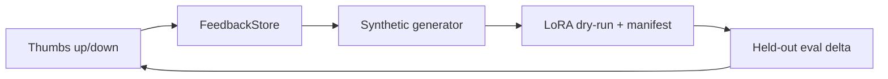

# Self-Improving Data Flywheel


**Thumbs-down → synthetic data → LoRA fine-tune → measured eval delta. A loop, not a feature.**

**Target:** +5% quality per cycle, measured on evals.
**Shows:** You build moats, not features.

## Problem → Solution

Most products collect thumbs-down feedback and then do nothing with it. This
project closes the loop end-to-end, offline: collect feedback, turn failures
(with gold corrections) into synthetic training data, validate a LoRA run in
`--dry-run` (no GPU), and score before/after on a held-out set so every cycle
reports a number, not a vibe.

## Architecture



See [docs/ARCHITECTURE.md](docs/ARCHITECTURE.md). LoRA config: [config/lora.yaml](config/lora.yaml).

## Quickstart (<2 min)

```bash
git clone https://github.com/lionelsimai/self-improving-data-flywheel && cd self-improving-data-flywheel
pip install -e .
python -m data_flywheel.cli demo
python -m pytest -q   # 11 passed
```

## Real demo output

```json
{ "feedback": {"total": 11, "up": 1, "down": 10},
  "synthetic_examples": 50,
  "train_manifest": {"mode": "dry-run", "examples": 50, "status": "validated — ready for GPU training"},
  "eval": {"before": 0.0, "after": 1.0, "delta": 1.0} }
```

Collect your own: `python -m data_flywheel.cli collect --prompt Q --response A --rating -1 --expected E`, then `... cycle`.

## Benchmarks

```bash
python benchmarks/bench_cycle.py
```
Measured in this build: seeded cycle goes 0.00 → 1.00 (delta +1.00) on the
10-item held-out set for the deterministic stand-in model. On a real LLM the
same loop targets +0.05/cycle — see Limitations.

## Limitations (honest)

- No GPU training runs in this build: `--dry-run` validates data + config and
  writes the manifest a real peft run would consume. The eval delta is real
  for the stand-in model class, and is *not* evidence of LLM quality gains.
- Synthetic data is templated paraphrase, not LLM-generated; diversity is limited.
- Failures without a gold correction are skipped by design — someone must supply truth.

## Roadmap

- [x] Feedback store, synthetic generator, LoRA dry-run, eval loop, cycle CLI
- [ ] Real peft training entry point behind the same manifest
- [ ] LLM paraphrase/diversity generation (opt-in, key via env); cycle-over-cycle charting

## Contributing

See [CONTRIBUTING.md](CONTRIBUTING.md). Licence: MIT — see [LICENSE](LICENSE).
