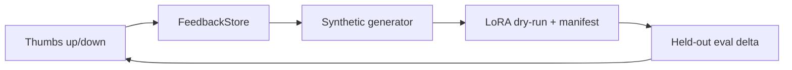

# Self-Improving Data Flywheel


**Thumbs-down → synthetic data → LoRA fine-tune → measured eval delta. A loop, not a feature.**

**Target:** +5% quality per cycle on a real model, measured on evals.
That is a *target*, not a result of this build — see the status note below.
**Shows:** You build moats, not features.

**Status of this build (0.1.1):** the loop machinery is verified end-to-end
on a deterministic stand-in model whose training data is *disjoint* from the
held-out eval set. On that stand-in the held-out delta is **+0.00**: it can
only answer questions it learned verbatim, so it cannot generalise — and any
nonzero delta in this setup would indicate leakage, not learning. No quality
improvement is claimed yet; the measured delta is a machinery check.

## Problem → Solution

Most products collect thumbs-down feedback and then do nothing with it. This
project closes the loop end-to-end, offline: collect feedback, turn failures
(with gold corrections) into synthetic training data, validate a LoRA run in
`--dry-run` (no GPU, with `config/lora.yaml` actually read and validated into
the manifest), and score before/after on a held-out set that the training
data never touches, so every cycle reports a number, not a vibe.

## Architecture



See [docs/ARCHITECTURE.md](docs/ARCHITECTURE.md). LoRA config: [config/lora.yaml](config/lora.yaml).

## Quickstart (<2 min)

```bash
git clone https://github.com/lionelsimai/self-improving-data-flywheel && cd self-improving-data-flywheel
pip install -e .
python -m data_flywheel.cli demo
python -m pytest -q   # 15 passed
```

## Real demo output

Excerpt of `python -m data_flywheel.cli demo` (0.1.1, full JSON includes the
LoRA manifest read from `config/lora.yaml`):

```json
{ "feedback": {"total": 11, "up": 1, "down": 10},
  "failures_used": 10,
  "synthetic_examples": 23,
  "train_manifest": {"mode": "dry-run", "examples": 23, "status": "validated — ready for GPU training"},
  "eval": {"before": 0.0, "after": 0.0, "delta": 0.0} }
```

The demo seed is a hand-written *training* set (Japan's capital, the Mona
Lisa, …) that shares no question with the held-out set — the zero delta is
the honest result for a verbatim-memorising stand-in. In 0.1.0 the demo
seeded training from the held-out set itself and reported delta +1.00;
that was train-on-test and has been removed.

Collect your own: `python -m data_flywheel.cli collect --prompt Q --response A --rating -1 --expected E`, then `... cycle`.

## Benchmarks

```bash
python benchmarks/bench_cycle.py
```
Measured in this build (0.1.1), with training and held-out data disjoint:

```text
Feedback: {'total': 11, 'up': 1, 'down': 10}  Synthetic examples: 23
Training-question fit after cycle: 1.00 (data pipeline works end-to-end)
Held-out eval — before: 0.00  after: 0.00 delta: +0.00
```

The benchmark asserts fit == 1.00 *and* held-out delta == 0.00 — in this
setup a nonzero delta would mean leakage. On a real LLM the same loop
targets +0.05/cycle — see Limitations.

## Limitations (honest)

- No GPU training runs in this build: `--dry-run` validates data + config and
  writes the manifest a real peft run would consume. The eval delta is a
  machinery check for the stand-in model class, and is *not* evidence of
  LLM quality gains — with disjoint data it is +0.00, because the stand-in
  cannot generalise beyond verbatim questions.
- Synthetic data is synonym-swap paraphrase, not LLM-generated; diversity is
  limited. The paraphrases and the evaluator's normalisation are independent
  by design (and by test): before 0.1.1 they shared a prefix/suffix codebook
  that made paraphrase "generalisation" automatic.
- Training and held-out data are disjoint by construction and by test
  (normalised question and record id). Failures without a gold correction
  are skipped by design — someone must supply truth.

## Roadmap

- [x] Feedback store, synthetic generator, LoRA dry-run, eval loop, cycle CLI
- [ ] Real peft training entry point behind the same manifest
- [ ] LLM paraphrase/diversity generation (opt-in, key via env); cycle-over-cycle charting

## Contributing

See [CONTRIBUTING.md](CONTRIBUTING.md). Licence: MIT — see [LICENSE](LICENSE).
