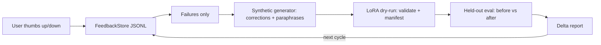

# Architecture

## Components
- **Feedback** (`feedback.py`): typed, validated (+1/-1) JSONL store; `failures()` is the flywheel input.
- **Synthetic** (`synthetic.py`): corrected examples + deterministic paraphrases. Records without a gold `expected` correction are skipped — the generator never invents gold answers.
- **Train** (`train.py`): `LoraConfig` (validated) + `dry_run()` which validates every example, hashes the dataset, and writes `manifest.json` + `train.jsonl`. No GPU needed; a real peft run consumes the same artifacts. Canonical config also in `config/lora.yaml`.
- **Evaluate** (`evaluate.py`): held-out set (10 topics) scored by a deterministic stand-in model whose knowledge is exactly what it trained on — so the delta is real for that model class and fully reproducible offline.
- **Cycle** (`cycle.py`): one call runs feedback -> synthetic -> dry-run -> eval delta.
- **Config** (`config.py`): environment-based settings (`FLYWHEEL_*`).

## Honest scope
The +5%/cycle target is a *measured* claim only on a real model + real held-out set. The offline stand-in proves the loop and the measurement, not LLM quality gains.
