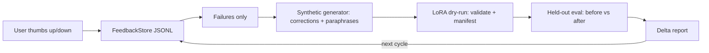

# Architecture

## Components
- **Feedback** (`feedback.py`): typed, validated (+1/-1) JSONL store; `failures()` is the flywheel input.
- **Synthetic** (`synthetic.py`): corrected examples + deterministic synonym-swap paraphrases. Records without a gold `expected` correction are skipped — the generator never invents gold answers. The paraphrase wording and the evaluator's normalisation share no codebook (tested).
- **Train** (`train.py`): `LoraConfig` (validated) + `dry_run()` which validates every example, hashes the dataset, and writes `manifest.json` + `train.jsonl`. When a LoRA YAML path is supplied, `load_lora_config()` parses and validates `config/lora.yaml` and its fields — not the dataclass defaults — are recorded in the manifest (`lora_config_source`). No GPU needed; a real peft run consumes the same artifacts.
- **Training data** (`training_data.py`): hand-written demo seed, disjoint from the held-out set by normalised question and by record id (asserted by test).
- **Evaluate** (`evaluate.py`): held-out set (10 topics) scored by a deterministic stand-in model whose knowledge is exactly what it trained on, verbatim. With disjoint training data its held-out delta is +0.00 by construction; the number is a machinery check, fully reproducible offline.
- **Cycle** (`cycle.py`): one call runs feedback -> synthetic -> dry-run -> eval delta.
- **Config** (`config.py`): environment-based settings (`FLYWHEEL_*`).

## Honest scope
The +5%/cycle figure is a *target* for a real model + real held-out set; it
is not a measured result of this build. The offline stand-in proves the loop
and the measurement machinery, not LLM quality gains — its held-out delta on
disjoint data is +0.00.
